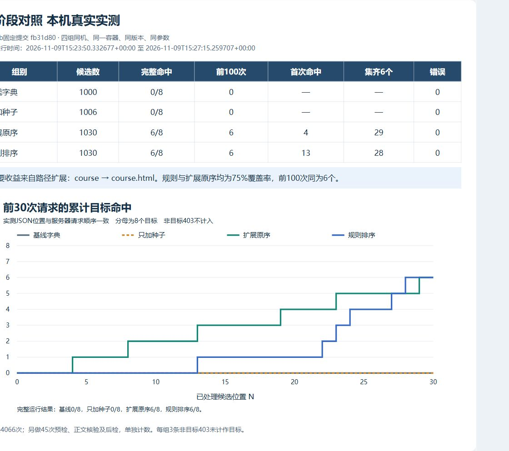
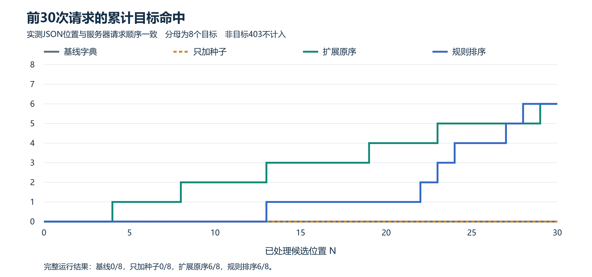

# E第二轮本机实测结果

实验日期：2026年11月9日。上传日期：2026年11月10日。输入代码固定于提交 fb31d804451101dea8545a0ae2b302b51b5aeba1。

四组均在同一台电脑、同一Apache/PHP容器中使用ffuf 2.3.0运行，单线程、20次/秒、超时5秒，匹配全部状态码并过滤404，不递归、不跟随重定向、不自动校准。

| 组别 | 候选数 | 确认目标 | 前100次命中 | 首次命中 | 集齐6个目标 |
| --- | ---: | ---: | ---: | ---: | ---: |
| 基线 | 1000 | 0/8 | 0 | 无 | 无 |
| 只加种子 | 1006 | 0/8 | 0 | 无 | 无 |
| 扩展原序 | 1030 | 6/8 | 6 | 第4次 | 第29次 |
| 规则排序 | 1030 | 6/8 | 6 | 第13次 | 第28次 |

扫描4066次，服务器日志逐条匹配候选顺序，全部零请求错误。另有45次脚本HTTP预检、正文复查和后检，浏览器截图访问另计。

## 结果怎么解释

- 主要收益来自路径扩展：只加course找不到course.html，补上后缀等变体后覆盖6个目标。
- 扩展原序和规则排序候选集合相同，完整覆盖率均为75%；规则集齐6个早1次，但首次命中晚9次，不能说规则全面更快。
- 两条未命中路径确实存在，但不在当前候选字典中。
- 每组3条.ht开头403属于非目标响应，不代表找到3个真实文件。
- 只加种子组把种子放在基线后，扩展原序把种子及变体放在前；比较早期收益时须说明候选集合与顺序同时改变。
- 本轮为小型自建受控靶场，每组一次，不作为真实网站泛化结论，也不是漏洞检出率。

## 可直接用于PPT的结果图

## 文件说明

01为真实首页；02至05为四组真实日志摘录的浏览器展示，保留命中与最终进度，并非原生终端截图；06为结果总览；07为8目标核验表；08为实际目标正文；09为环境预检。

高清PNG和SVG适合插入PPT，四组结果汇总.csv可用于制作表格。完整JSON、原日志和带图Word报告已在组长本地PPT准备文件夹保存，本次先上传结果图和汇总。
